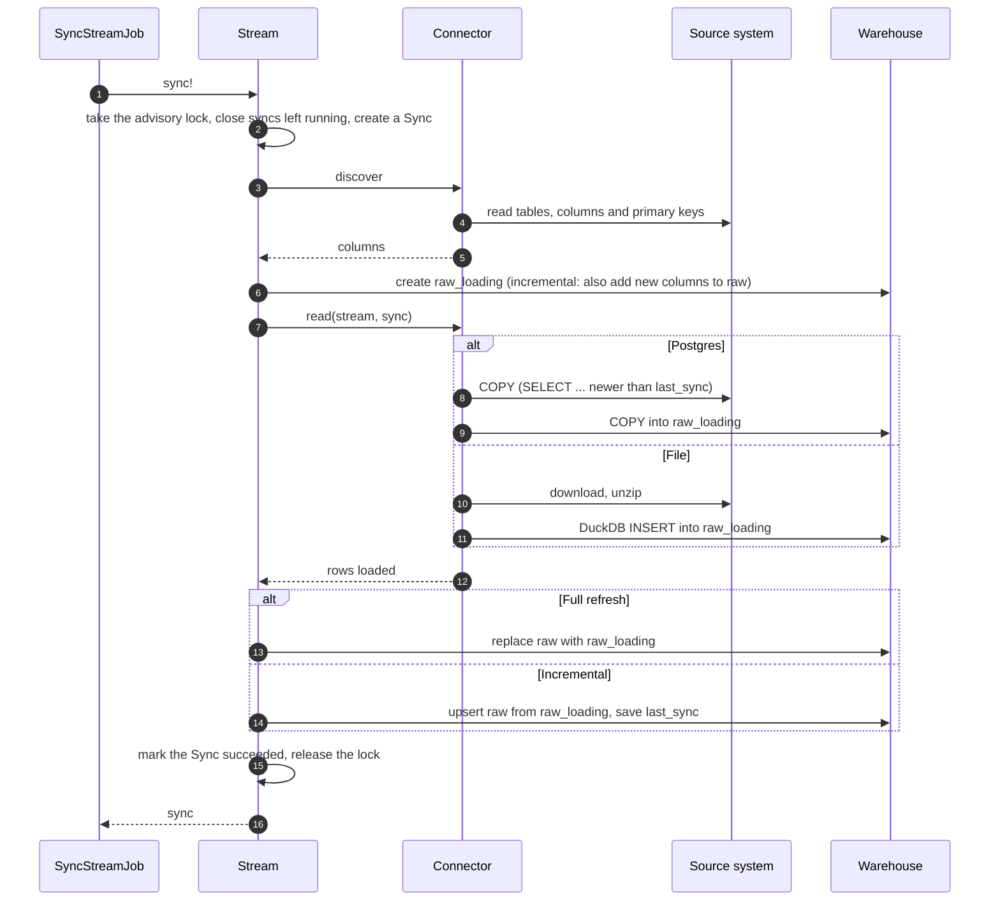
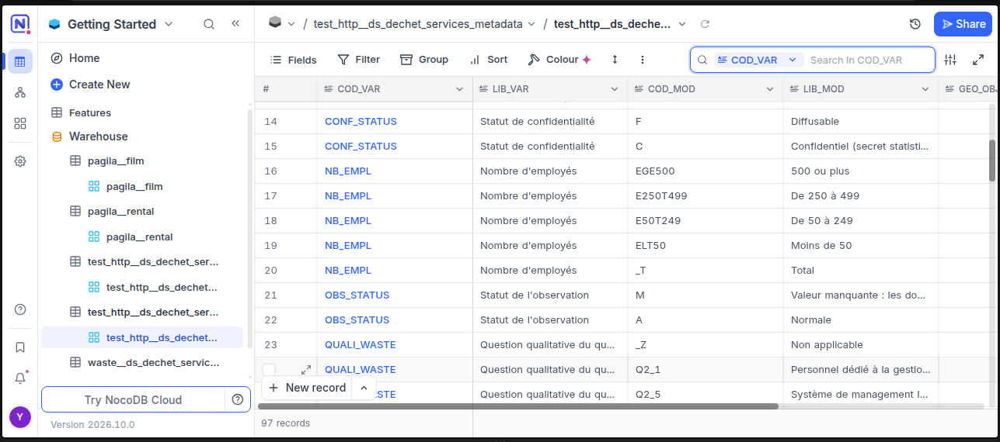

# makhazen

[](https://github.com/T81oub/makhazen/actions/workflows/backend.yml)


**makhazen** ("warehouses") is a self-hosted ELT platform. Point it at a
Postgres database or a data file, pick what you want, and it keeps a copy in a
Postgres warehouse, on a schedule.

## Features

- **Sources:** Postgres databases, [data.gouv.fr](https://www.data.gouv.fr) datasets, and files at any URL
- **File formats:** CSV, Parquet, JSON and Excel, plain, zipped or gzipped, in UTF-8, UTF-16 or Latin-1
- **Sync modes:** full refresh, or incremental on an `updated_at` column with upserts on the primary key
- **Fast loading:** Postgres tables are streamed with `COPY`. Files are read by DuckDB and written straight into the warehouse, without passing through Ruby
- **Safe by default:**
  - a failed sync leaves the previous copy untouched
  - two syncs of the same table can't run at once
  - a sync left running by a crash is closed before the next one starts
- **Schema changes:** new source columns are added to the warehouse, and tables removed at the source are flagged
- **Lineage:** every row records when it was loaded and by which sync (`_synced_at`, `_sync_id`)
- **Scheduling:** each stream syncs hourly, daily or monthly, with retries on connection errors
- **Browsing:** the warehouse is browsable in [NocoDB](https://github.com/nocodb/nocodb), with search, filters and record pages

## How it works

```
  Sources                  makhazen (Rails)                     Warehouse (Postgres)

  Postgres     ─┐                                         ┌──►  raw_loading   new copy, being written
  data.gouv    ─┼──►  connector ──►  sync  ───────────────┤
  files (URL)  ─┘     check            lock, retry,       └──►  raw           live copy, swapped or
                      discover         stamp rows                              upserted in one step
                      read
```

1. A **source** is where the data lives: a database, a dataset, a list of URLs.
2. `discover` lists its **streams**, meaning its tables or files, with their columns and primary keys. You choose which ones to sync.
3. A **sync** loads a stream into `raw_loading`, then moves it into `raw` in a single transaction:
   - a full refresh swaps the whole table;
   - an incremental sync upserts only the rows that changed.
4. Every sync is recorded with its status, row count and error, if any.

### One sync, step by step



If any step fails, `raw_loading` is dropped, the Sync is marked failed with its
error, and `raw` keeps its previous copy.

Connector settings, sync modes and console examples are in the [backend README](backend/README.md).

## Getting started

The only requirement is Docker with Docker Compose. Ruby, Node and Postgres all run in containers.

```bash
git clone https://github.com/T81oub/makhazen.git
cd makhazen
./start
```

The first start installs gems and npm packages, so it takes a few minutes. Then:

| Service | URL |
|---|---|
| API health check | http://localhost:3000/up |
| NocoDB | http://localhost:8080 |
| Frontend | http://localhost:5173 |

`./start` follows the logs, and Ctrl+C only detaches from them. `./stop` stops everything; your data stays in `storage/`.

### Sample source: Pagila

[Pagila](https://github.com/devrimgunduz/pagila) is a small DVD-rental database. It has everything a sync engine has to handle: foreign keys, enums, arrays, a partitioned table and `last_update` timestamps.

```bash
mkdir -p storage/seeds/pagila
curl -fL -o storage/seeds/pagila/01-schema.sql https://raw.githubusercontent.com/devrimgunduz/pagila/pagila-v3.1.0/pagila-schema.sql
curl -fL -o storage/seeds/pagila/02-data.sql   https://raw.githubusercontent.com/devrimgunduz/pagila/pagila-v3.1.0/pagila-data.sql
```

Create `storage/seeds/pagila/03-reader.sql` with a read-only user:

```sql
CREATE ROLE makhazen_reader LOGIN PASSWORD 'reader';
GRANT CONNECT ON DATABASE pagila TO makhazen_reader;
GRANT USAGE ON SCHEMA public TO makhazen_reader;
GRANT SELECT ON ALL TABLES IN SCHEMA public TO makhazen_reader;
ALTER DEFAULT PRIVILEGES IN SCHEMA public GRANT SELECT ON TABLES TO makhazen_reader;
```

Then start the stack with it, and sync it from the Rails console:

```bash
./start --pagila
./backend/exec bin/rails console
```

```ruby
pagila = Source.create!(name: "pagila", connector: "postgres", config: {
  "host" => "source_db", "port" => 5432, "database" => "pagila",
  "username" => "makhazen_reader", "password" => "reader"
})
pagila.discover!
pagila.streams.find_by(name: "rental").sync!.rows_loaded
```

## Browsing the warehouse

NocoDB shows every warehouse table as a spreadsheet, and new tables appear after each sync.



1. Create a read-only user, once:

   ```bash
   docker compose exec -T db psql -U makhazen -d makhazen_warehouse_development < nocodb/viewer.sql
   ```

2. Open http://localhost:8080 and create a local account.
3. In a project, add a data source and create a new **PostgreSQL** connection with these settings:

   | Field | Value |
   |---|---|
   | Host / Port | `db` / `5432` |
   | Database | `makhazen_warehouse_development` |
   | Schema | `raw` |
   | User / password | `makhazen_viewer` / `viewer` |
   | Allow Data Edit | off |

## Commands

| Command | What it does |
|---|---|
| `./start` | Start the stack and follow the logs |
| `./start --pagila` | Same, with the Pagila source database |
| `./stop` | Stop everything |
| `./backend/exec` | Open a shell in the backend container |
| `./backend/exec bin/rails console` | Open a Rails console |
| `./backend/rspec` | Run the backend tests |
| `./frontend/exec` | Open a shell in the frontend container |
| `./frontend/test` | Run the frontend tests |

## Tech stack

| | |
|---|---|
| Backend | Ruby 3.4, Rails 8.1 (API mode) |
| Warehouse and app database | PostgreSQL 16 |
| Extraction | Sequel for Postgres sources, DuckDB for files |
| Background jobs | Solid Queue, running on Postgres with no Redis needed |
| Data browsing | NocoDB |
| Frontend | React, TypeScript, Vite |
| Tests and CI | RSpec, WebMock, Vitest, GitHub Actions |

## Project layout

```
makhazen/
├── backend/                    Rails app: connectors, syncs, jobs
├── frontend/                   React app
├── nocodb/                     Read-only warehouse user for NocoDB
├── storage/                    Local data, not in git
├── docker-compose.yml          db, backend, frontend, nocodb
├── docker-compose.pagila.yml   Optional sample source
└── start, stop                 Helper scripts
```
